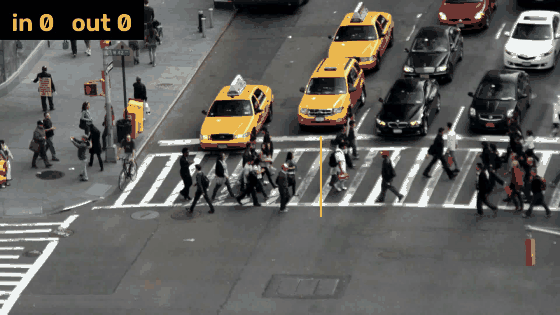
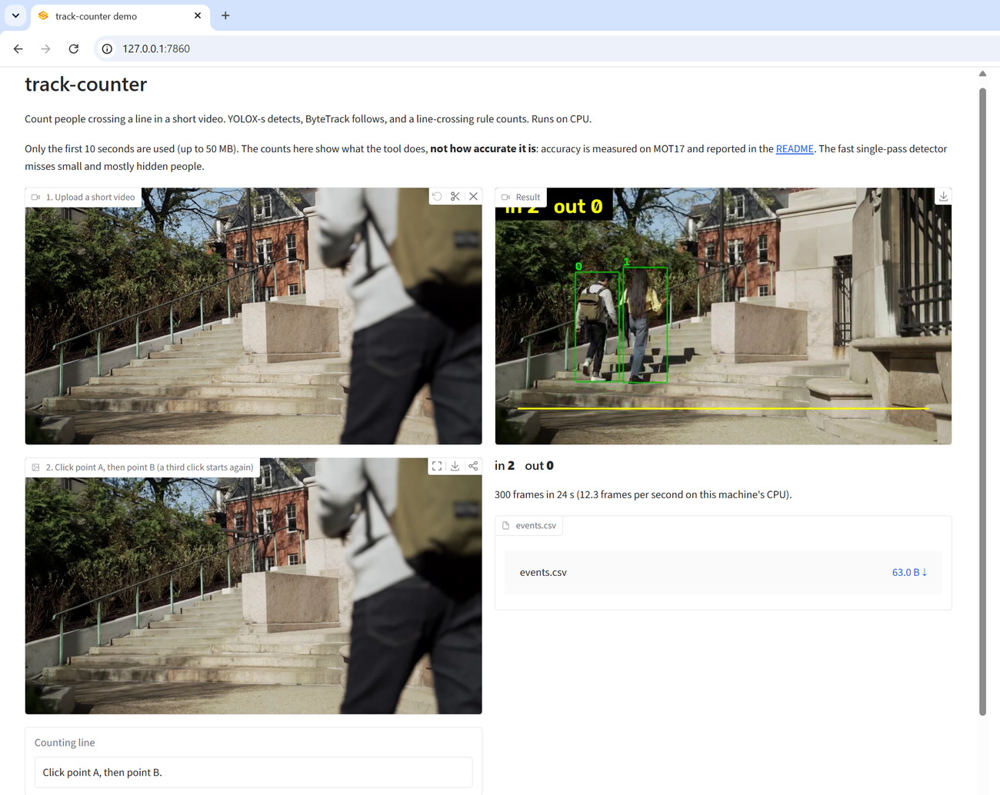

# track-counter


Count people crossing a line in a video, and see how accurate the count really is. Every accuracy number below is measured against ground truth, with the pass marks written down before each run.

## Quick Start

```bash
git clone https://github.com/Onkar-Gupta/object-tracking-counter && cd object-tracking-counter
pip install -e ".[onnx]"
curl -L --create-dirs -o models/yolox_s.onnx https://github.com/Megvii-BaseDetection/YOLOX/releases/download/0.1.1rc0/yolox_s.onnx
track-counter draw-line --video my_video.mp4          # click two points, it prints the --line value
track-counter run --video my_video.mp4 --line X1,Y1,X2,Y2 --save-video counted.mp4
```



*A crowded scene, which is the hard case: boxes overlap in about 64% of the frames, and the count is not checked against ground truth. Footage: "Busy street in the city" from Mixkit, see [docs/demo_credit.md](docs/demo_credit.md).*

## Try it in your browser

```bash
pip install -e ".[onnx]" gradio==6.31.0
python demo/app.py        # then open http://127.0.0.1:7860
```



Upload a short clip (first 10 seconds, up to 50 MB), click two points to draw the line, press Count. You get the annotated video, the in and out counts and `events.csv`. It runs on the CPU: 300 frames took 24 s on the test laptop. This screenshot is the easy case, two students who never overlap, counted in 2, out 0. It works best when people are separate. When they overlap, the detector misses more of them, as in the crowded GIF above (many people in the left crowd have no box). These counts show what the tool does, not how accurate it is. Footage credit: [docs/demo_credit.md](docs/demo_credit.md). More in [demo/README.md](demo/README.md).

## What it does

- Reads a video file or webcam, finds people with YOLOX (ONNX, CPU or GPU), follows them with ByteTrack, and counts each person who crosses your line, in and out.
- Writes `events.csv` (one row per crossing, with frame, time and track ID), `summary.json`, and optionally an annotated video.
- Counts a crossing only after the person has stayed on the far side for N frames (default 3), with a small dead band around the line, so a person standing on the line is not counted again and again.
- Includes an evaluation harness: event precision and recall against MOT17 ground truth, with bootstrap intervals and a recall split by how visible each person was.

## Results

**Setup.** MOT17 sequences 02, 04 and 09 (static cameras), 6 lines in [eval/lines.yaml](eval/lines.yaml) (one horizontal and one vertical per sequence, sharing the same people), committed before any result existed. A predicted crossing matches a true one if it is in the same direction, within 1 second and within 10% of the line length. Every setting was tuned on sequences 02 and 04 only, and 09 was held out. Intervals are 95% bootstrap intervals over people. All protocols are in [eval/](eval/) and were committed before their runs.

**The anchor** is the point of each box that must cross the line. The feet anchor (bottom centre) is the usual definition and is the headline. The box-centre anchor is easier for hidden people and has fewer true events, so it is a second table, not a replacement.

### Feet anchor (headline): 146 true crossings

| Detector | Precision | Recall [95% interval] | F1 | Recall gain over FRCNN [95% interval] |
|---|---|---|---|---|
| **Public FRCNN detections (baseline)** | **0.907** | **0.466** [0.37, 0.57] | **0.615** | |
| YOLOX-s single pass (the default, 19 fps on CPU) | 0.655 | 0.493 [0.39, 0.60] | 0.562 | +0.027 [-0.072, +0.131] |
| YOLOX-s tiled | 0.658 | 0.500 [0.40, 0.61] | 0.568 | +0.034 [-0.046, +0.112] |
| YOLOX-m tiled | 0.606 | 0.548 [0.45, 0.65] | 0.576 | +0.082 [0.000, +0.175] |
| YOLOX-s fine-tuned on other MOT17 scenes, tiled (weights not published) | 0.752 | 0.582 [0.49, 0.68] | 0.656 | +0.116 [+0.031, +0.197] |

### Box-centre anchor: 112 true crossings

| Detector | Precision | Recall [95% interval] | F1 | Recall gain over FRCNN [95% interval] |
|---|---|---|---|---|
| **Public FRCNN detections (baseline)** | **0.970** | **0.580** [0.48, 0.69] | **0.726** | |
| YOLOX-s single pass (the default) | 0.812 | 0.500 [0.40, 0.61] | 0.619 | -0.080 [-0.190, +0.028] |
| YOLOX-s tiled | 0.693 | 0.625 [0.54, 0.70] | 0.657 | +0.045 [-0.046, +0.132] |
| YOLOX-m tiled | 0.882 | 0.598 [0.50, 0.70] | 0.713 | +0.018 [-0.070, +0.105] |
| YOLOX-s fine-tuned, tiled (weights not published) | 0.848 | 0.598 [0.50, 0.69] | 0.702 | +0.018 [-0.083, +0.116] |

**The pass mark** (fixed before the runs): a detector counts as better only if its recall gain over the tuned FRCNN detections has an interval that excludes zero **and** its precision is at least 0.80. **No detector passes at either anchor.** The fine-tuned model comes closest: at the feet anchor its recall gain is clear but its precision is 0.75, and at the centre anchor its precision passes but the recall gain is inside the error bars.

### Who gets missed

Event recall by how visible the crossing person was (feet anchor, found / true crossings):

| Detector | Under 30% visible (50) | 30 to 50% (17) | 50 to 70% (8) | 70% or more (71) |
|---|---|---|---|---|
| Public FRCNN | 0.08 (4) | 0.12 (2) | 0.50 (4) | 0.82 (58) |
| YOLOX-s single pass | 0.28 (14) | 0.29 (5) | 0.38 (3) | 0.70 (50) |
| YOLOX-s fine-tuned, tiled | 0.36 (18) | 0.29 (5) | 0.75 (6) | 0.79 (56) |

When a person is clearly visible, the counter works: FRCNN gets 82% of those crossings. When a person is mostly hidden, almost nobody is counted: FRCNN gets 6 of the 67 crossings by people under half visible. The YOLOX models find more of them, but they also create more false counts, which is why precision falls.

### Speed on CPU

Full chain (detect, track, count) on 1080p video, single pass at 640 x 640, ONNX Runtime on the CPU only, 150 timed frames after a 10-frame warm-up. Intel Core Ultra 9 185H laptop (22 threads), plugged in. A typical laptop will be slower. Source: [reports/cpu_benchmark.json](reports/cpu_benchmark.json).

| Model | Frames per second | Detector time per frame |
|---|---|---|
| **YOLOX-s (default)** | **19.1** | 51 ms |
| YOLOX-m | 8.6 | 116 ms |
| YOLOX-l | 4.4 | 226 ms |
| YOLOX-s tiled (`--tiled`, 40 timed frames) | 2.1 | 478 ms |

Tracking and counting add under 1 ms per frame. Video decoding is about 4 ms per frame. Tiled detection (`--tiled`) runs the model about 9 times per frame, so it is about 9 times slower than the default and is for accuracy, not speed. Its row uses 40 timed frames from [reports/cpu_benchmark_tiled.json](reports/cpu_benchmark_tiled.json), the same clip, line and machine as the rest.

### What we found

1. **Counting is mostly a detection problem.** The tracker and the counting rule behave. What limits the count is who the detector can see.
2. **Part of the gap is how the test is labelled.** MOT17 boxes the whole body, even when most of it is hidden. Normal detectors box only what they can see. On top of that, MOT17 leaves many real people unlabelled, which counts against precision.
3. **Fine-tuning helped but did not pass the mark.** Training YOLOX-s for 20 epochs on four other MOT17 scenes cut false counts a lot (centre-anchor precision 0.69 to 0.85) and kept most of the extra recall. It did not beat the tuned public detections under the rule above. MOT17 is non-commercial, so those weights are not published. The scripts are in [training/](training/).
4. **Things that did not help:** smoothing the anchor point, and a higher non-maximum suppression threshold (recall at 90% precision fell from 0.434 to 0.386). The clean-up rules (cooldown, event merging) and the tracker choice trade recall for precision: for YOLOX-s tiled, precision went from 0.48 to 0.66 while recall went from 0.60 to 0.50, and it still did not reach the pass mark. Details are in [eval/](eval/) and [reports/](reports/).

### Limits to know about

- Only 146 true crossings (112 at the centre anchor) on 3 static scenes, so the intervals are wide. Most differences between detectors are inside them.
- The public FRCNN detections come with MOT17 and may have been trained on these scenes. That is **unverified**, and it would favour them.
- A manual check of 20 true crossings found none wrong, but the labels are not perfect.
- Static cameras only. One training run, one seed.
- The demo clip has no ground truth. It shows what the tool does, not how accurate it is.

## How it works

```
video --> detector (YOLOX, ONNX) --> tracker (ByteTrack) --> line counter --> events.csv, summary.json
                                                                          \--> annotated video (optional)
```

The counter takes one point per tracked box (the feet or the centre), works out which side of the line it is on, and emits a crossing once the point has stayed on the other side for N frames. Direction is "in" for a move from the positive to the negative side of the line A to B, and "out" for the reverse. The counter is plain NumPy with synthetic-track tests, and it does not depend on any detector.

## Project structure

```
track_counter/   counter.py, tracking.py, detectors.py, pipeline.py, evaluate.py, cli.py
scripts/         make_detections, score_detector, compare_detectors, ablate_*, benchmark_cpu, make_gif
eval/            lines.yaml and the pre-registered protocols
reports/         every measured result, as JSON
training/        recipe to fine-tune YOLOX on MOT17 tiles (research only)
tests/           72 tests
docs/            demo GIF, demo screenshot and their credits
demo/            Gradio browser demo (app.py)
```

## Configuration

Everything lives in [config.yaml](config.yaml). The main settings:

| Key | Default | Meaning |
|---|---|---|
| `detector.model` | `models/yolox_s.onnx` | YOLOX ONNX file |
| `detector.confidence` | 0.4 | Detection score floor |
| `tracker.name` | `bytetrack` | `bytetrack`, `ocsort` or `botsort` |
| `counter.line` | example | Line A to B in pixels, or pass `--line` |
| `counter.anchor` | `bottom_center` | `bottom_center` or `center` |
| `counter.min_frames_on_far_side` | 3 | Frames on the far side before a crossing counts |
| `counter.margin_px` | 4 | Dead band around the line |

## Use your own video

```bash
track-counter draw-line --video my_video.mp4 [--frame 100]
track-counter run --video my_video.mp4 --line X1,Y1,X2,Y2 [--tiled] [--device gpu] [--start N] [--frames N] [--save-video out.mp4]
python scripts/make_gif.py --video out.mp4 --out demo.gif
```

`--tiled` is slower and finds smaller people. `--device gpu` needs `pip install onnxruntime-directml` in place of `onnxruntime` (Windows, DirectX). To use another detector, write its boxes as a MOT-format `det.txt` and pass `--detections det.txt --fps 30`. The counter works on any tracked box, but the shipped detector finds people only.

## Reproduce the results

MOT17 is licensed CC BY-NC-SA 3.0, so it is not in this repository. Download it for local research with `python scripts/download_mot17.py`, then run the scripts in `scripts/` in the order shown in each protocol under `eval/`. `scripts/benchmark_cpu.py` produces the speed table.

## Docker

A CPU image. The model and your videos are mounted when you run it, not stored in the image.

```bash
docker build -t track-counter .
# run from a folder that holds models/yolox_s.onnx and your video
docker run --rm -v "$PWD:/data" track-counter run --video my_video.mp4 --line X1,Y1,X2,Y2 --save-video counted.mp4
```

In PowerShell use `${PWD}` instead of `$PWD`. Output (`runs/latest/` and the annotated video) appears in the mounted folder. `draw-line` needs a window, so run it on your machine, not in Docker.

The image is 1.48 GB (measured), mostly OpenCV and SciPy pulled in by the tracking library. CI builds it and runs a smoke test on every push, and a 60-frame run of the demo clip was checked inside the container on Windows (12.8 frames per second including start-up).

## Roadmap

- [x] Counter with synthetic-track tests, MOT17 evaluation with intervals, pre-registered ablations
- [x] Video input, `draw-line`, annotated video, CPU benchmark, demo GIF
- [x] Docker image
- [x] Browser demo (Gradio), runs locally
- [ ] Host the browser demo on a Hugging Face Space
- [ ] Count other classes (cars, buses), the counter already does not care
- [ ] Try crowd-aware box filtering (Soft-NMS, Set-NMS)
- [ ] Fine-tune and test on a new, labelled scene, as a true held-out check

## Licence

MIT, see [LICENSE](LICENSE). The demo footage is credited in [docs/demo_credit.md](docs/demo_credit.md). MOT17 and anything trained on it stay out of this repository.

## Author

Onkar Gupta - [LinkedIn](https://linkedin.com/in/onkar-gupta-ai)
